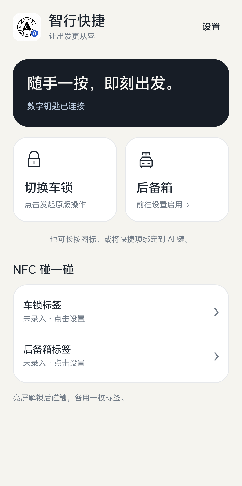
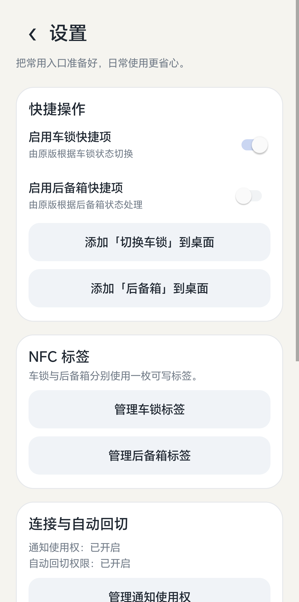
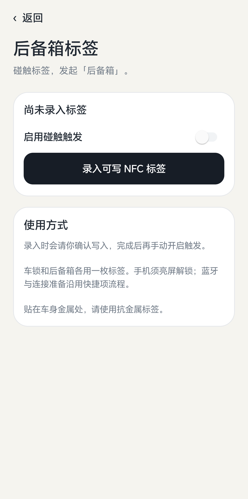

# 智行快捷 · HimaWidgetBridge

通过原版鸿蒙智行的小组件，为 Android 手机提供「切换车锁」和「后备箱」快捷入口，可用于桌面快捷项、手机 AI 键、系统场景及可写 NFC 贴纸。

这是独立辅助应用，包名为 `com.eric.himawidgetbridge`。使用时需要安装原版鸿蒙智行、登录自己的账号，并完成车辆小组件绑定。车辆状态、鉴权及蓝牙／网络控制方式由原版处理。

## 界面预览

<p>
  <a href="docs/screenshots/home.png"></a>
  <a href="docs/screenshots/settings.png"></a>
  <a href="docs/screenshots/trunk-tag.png"></a>
</p>

依次为 **首页、设置、NFC 标签管理**，点击图片可查看原图。截图取自 0.6.0 实机界面，0.6.1 沿用这些页面布局；连接状态、开关和标签状态仅作示例，以自己的手机为准。

## 下载与安装

[直接下载 v0.6.1 通用 APK](https://github.com/xiaoyao9933/hima-widget-bridge/releases/download/v0.6.1/hima-widget-bridge-0.6.1-universal.apk) · [版本说明与 SHA-256 校验文件](https://github.com/xiaoyao9933/hima-widget-bridge/releases/tag/v0.6.1)

1. 在手机浏览器打开上面的下载链接，下载 `hima-widget-bridge-0.6.1-universal.apk`。在 Release 页面中下载 APK 文件，无需下载 `Source code` 压缩包。
2. 打开下载完成的 APK，按系统提示安装。若系统要求安装来源授权，为这次使用的浏览器或文件管理器开启「允许安装此来源应用」，再返回安装。Android 8.0 及以上按安装来源分别授权，详见 [Android 官方说明](https://developer.android.com/distribute/marketing-tools/alternative-distribution#user-opt-in-for-installing-unknown-apps)。
3. 安装完成后，打开桌面上的「智行快捷」，开始下面的首次配置。

- Android 8.0 及以上；NFC、蓝牙硬件均为可选。
- universal APK 没有架构专属的原生库，使用同一安装包。实际兼容性仍取决于手机系统、原版 App 版本和车辆小组件。
- 已安装此前同签名「智行快捷」的用户可直接覆盖安装，保留设置和绑定。
- 当前验证设备为荣耀 Magic9／MagicOS 11。**本版仅适配原版鸿蒙智行 `3.0.2.320`**，其他原版版本会显示需要适配；其他手机和车型仍需实测。

## 首次配置教程

配置顺序：**原版准备 → 绑定小组件 → 开启连接权限 → 启用快捷项 → 添加桌面／AI 键入口**。NFC 标签是可选项，桌面快捷项可单独使用。

### 1. 先准备原版鸿蒙智行

安装当前适配版本的原版鸿蒙智行，登录自己的账号，确认车辆可在原版中正常控制。若希望使用蓝牙数字钥匙，在原版中先完成数字钥匙开通和连接准备。

助手使用原版的 4×4 车辆小组件。仅安装助手无法完成账号登录、车辆授权或原厂 NFC 车钥匙开通。

### 2. 绑定车辆小组件

1. 打开「智行快捷」，点首页右上角 **设置**。
2. 在设置页向下滚动到 **车辆小组件**，点 **绑定车辆小组件**。
3. 在 Android 小组件授权框中点 **创建**／系统对应的允许按钮，然后返回助手。
4. 确认显示 **已绑定鸿蒙智行小组件**，等待原版按钮加载。

首次绑定和重新绑定都会关闭两个快捷项，需要在第 4 步手动启用。

### 3. 开启连接与自动回切权限

在设置页的 **连接与自动回切** 卡片中分别完成：

| 点击入口 | 在系统设置中操作 | 返回助手后检查 |
| --- | --- | --- |
| 管理通知使用权 | 找到「智行快捷」，开启通知使用权，确认系统提示 | 通知使用权：已开启 |
| 管理使用情况访问权限 | 找到「智行快捷」，允许使用情况访问 | 自动回切权限：已开启 |

通知使用权用于读取原版数字车钥匙连接状态；使用情况访问用于预热时判断原版前台页面并自动返回。系统设置页的名称会因手机而异，授权后需返回助手。

首次实际触发时，若手机请求 **附近设备** 权限，按系统提示允许。蓝牙关闭时可能还会出现单独的 **开启蓝牙** 确认框，需要再次确认；Magic9 上该框可能每次出现。

### 4. 启用需要的快捷项

返回设置页顶部 **快捷操作**，打开 **启用车锁快捷项**；需要后备箱入口时，再打开 **启用后备箱快捷项**。

若提示「请先绑定并确认原版有可用的…按钮」，先检查小组件绑定和原版车辆状态。返回首页后，已就绪的动作卡应显示 **点击发起原版操作**。钥匙连接状态会随是否在车旁和原版后台状态变化，截图中的「已连接」不是所有手机的初始状态。

### 5. 添加桌面快捷入口

在设置页点击 **添加「切换车锁」到桌面** 或 **添加「后备箱」到桌面**，按桌面系统提示确认添加。

也可以长按「智行快捷」应用图标，从弹出的快捷项中选择对应动作；支持拖拽的桌面可将该项拖到桌面。某些桌面不支持固定快捷项，可使用长按菜单。

**桌面上的普通「智行快捷」应用图标只打开首页；独立的「切换车锁」／「后备箱」快捷项才会发起对应操作。**

### 6. 配置 AI 键或智能场景（可选）

1. 进入手机系统提供的 AI 键、快捷按键或智能场景设置。
2. 选择 **应用快捷方式／应用快捷项** 一类动作，找到「智行快捷」。
3. 指定 **切换车锁** 或 **后备箱**，保存后使用对应按键／场景触发。

不同手机支持的动作不同。如果系统只提供 **打开应用**，选择「智行快捷」只会打开首页；此时使用桌面独立快捷项或下面的 NFC 标签。

### 7. 确认一次实际操作

在车旁按需点一次 **切换车锁**，观察原版提示和车辆实际状态。首次钥匙准备可能短暂打开鸿蒙智行，再自动回到助手继续；同一已准备会话后续触发会跳过预热。

「切换车锁」由原版按当前状态决定锁车或解锁。「后备箱」调用原版对应按钮，原版可能按当前状态开启或关闭。原版要求的安全码或确认仍由用户完成；「已触发原版…」不是车辆完成回执。

## NFC 碰一碰配置（可选）

先完成上面的快捷项配置。车锁和后备箱各用一枚普通可写 NDEF 标签；贴在车身金属位置时使用抗金属标签。

1. **进入标签页**：开启手机 NFC，在首页点 **车锁标签** 或 **后备箱标签**，再点 **录入可写 NFC 标签**。上方第三张截图以后备箱为例，两种用途的步骤相同。
2. **第一次碰触：读取**。将标签贴近手机 NFC 感应区，读取身份、容量和可写状态。这一步不写入，也不操作车辆。
3. **确认覆盖**。阅读写入提示，确认后继续。写入会覆盖这枚标签原有的 NDEF 内容，标签仍可重新写入。
4. **移开再碰：写入**。完全移开标签，再碰触同一枚标签，保持贴近，等待结果。
5. **按提示再次验证**。若出现 **再次碰触，验证写入**，再完全移开、碰触同一枚标签并保持。只有身份和本次标识匹配，才会显示 **标签已录入**；验证期间不要退出录入页。
6. **手动启用**。成功后默认 **触发关闭**。确认对应车锁／后备箱快捷项已开启，再打开标签页的 **启用碰触触发**。
7. **日常使用**。退出录入页，在手机 **亮屏且已解锁** 时碰触标签，发起对应原版操作。

两枚标签的绑定、开关与移除互不影响；同一标签不能同时绑定两种操作。重新录入会关闭该用途的触发，移除本机绑定不擦除实体标签。取消或离开尚未完成的验证会结束本次录入。

这是快捷触发贴纸，车控仍依赖原版 App。普通 NFC 手机的 HCE 模拟不能替代录入所需的稳定 UID 可写标签。

## 常见配置问题

| 现象 | 检查方法 |
| --- | --- |
| 首页显示「原版版本需要适配」 | 检查原版是否为 `3.0.2.320`；本版对其他版本不执行快捷车控，需要后续适配。 |
| 快捷项开关无法开启／按钮未就绪 | 先确认设置页显示「已绑定鸿蒙智行小组件」，再打开原版确认登录、车辆和对应按钮可用。 |
| 点击 AI 键只进入首页 | 检查绑定的是具体应用快捷项，而不是「打开应用」。 |
| 没有自动回到助手继续 | 检查「自动回切权限：已开启」；准备期间切换应用、按 Home 或提前手动返回会取消本次请求。 |
| 钥匙状态未连接／未知 | 打开原版确认数字钥匙状态，检查通知使用权；离车断开和系统后台限制都可能影响连接。 |
| 蓝牙授权后仍弹出开启确认 | 附近设备授权与开启蓝牙确认是两步；部分系统只允许「本次允许」，不能保证静默开启。 |
| NFC 标签已录入但碰触无反应 | 检查手机 NFC、亮屏解锁、标签触发开关和对应快捷项；先退出录入页，并检查是否处于防重复倒计时。 |
| NFC 要求再次验证／验证失败 | 完全移开后重新碰触同一标签并保持；内容未匹配就不会保存新绑定，可重新录入或更换可写标签。 |
| 操作仍要求安全码 | 控制方式和鉴权由原版选择；原版准备流程不能保证每次都走蓝牙，按原版提示完成。 |

## 连接准备与操作保护

- 蓝牙关闭时先尝试开启；手机系统不允许直接开启时显示系统确认框。
- 新的钥匙会话、通知重建或历史未知时，打开原版短暂预热并自动返回；同一已准备会话跳过预热。
- 未连接时最多等待 10 秒，再由原版选择控制方式。通知「已连接」和页面预热无法保证最终点击时车控模块已就绪，仍可能要求安全码。
- 两个动作共用防重复保护；倒计时代表助手的触发保护，不是车辆执行回执。
- 「已触发原版…」表示已点击原版按钮，车辆结果由原版确认。

## 权限与数据

| 权限 | 用途 |
| --- | --- |
| 小组件绑定 | 经系统授权加载原版车辆小组件 |
| 附近设备／蓝牙 | 检查蓝牙并发起开启请求 |
| 通知使用权 | 检查原版数字车钥匙通知和会话变化 |
| 使用情况访问 | 预热时判断前台并自动回切 |
| NFC | 录入和读取两种快捷标签 |

助手没有 Internet、定位、无障碍、Shizuku 或悬浮窗权限。标签只包含专用触发标识与应用信息；本机保存标签身份及标识，不保存车辆密钥。录入诊断仅记录阶段、容量、回读结果和异常类型，不记录 UID、标识或完整标签内容。

## 从源码构建

需要 Python 3、JDK 17、Android SDK Platform 34、Build Tools 36.0.0、Eclipse ECJ 3.37.0。无需 Gradle 或 NDK。

安装 SDK 包可使用 Android Studio 的 SDK Manager，或 [Android 官方命令行工具](https://developer.android.com/tools/sdkmanager)：

```bash
sdkmanager "platforms;android-34" "build-tools;36.0.0"
```

在仓库目录下载编译器：

```bash
mkdir -p .build-tools
curl -fL https://repo.maven.apache.org/maven2/org/eclipse/jdt/ecj/3.37.0/ecj-3.37.0.jar \
  -o .build-tools/ecj-3.37.0.jar
```

ECJ 文件的 SHA-256 应为 `cde026ff966b48b5e5f148b6f041ceff3cf4f85cf75155f4ec0f40e4ee14b545`。

将 `JAVA_HOME` 指向 JDK 17，`ANDROID_HOME` 指向 Android SDK 根目录，然后运行：

```bash
python3 -m unittest discover -s tests -p 'test_build_config.py' -v
python3 build.py
```

构建自动执行 200 项纯策略检查，生成 DEX，进行 16KB ZIP 对齐和 v2/v3 签名，输出 `dist/hima-widget-bridge-0.6.1.apk`。没有 JNI 原生库，输出为通用 APK。

首次自行构建会在被 Git 忽略的 `.local-signing/` 创建开发签名。自建签名与本仓库 Release 签名不同，不能覆盖安装 Release；后续自建升级需保留同一签名文件。

可选环境变量：

| 变量 | 用途 |
| --- | --- |
| `HIMA_ECJ` | ECJ JAR 路径 |
| `HIMA_BUILD_TOOLS` | 含 `aapt2`、`zipalign`、`lib/d8.jar` 的 Build Tools 目录 |
| `HIMA_ANDROID_JAR` | 编译所用 `android.jar` |
| `HIMA_KEYSTORE` | 自己的 PKCS12 签名文件 |
| `HIMA_KEY_ALIAS` | 签名别名，默认 `widget-helper` |
| `HIMA_KEYSTORE_PASSWORD` | 签名密码，通过环境传递给签名工具 |
| `HIMA_RUNTIME` | 可选的本地固定工具目录；普通 SDK 构建不需要 |

设备测试 APK 可在主应用构建后运行 `python3 device-tests/build.py` 生成。设备测试必须按具体 runner 的范围执行；普通构建不会连接手机或操作车辆。NDEF 格式与隔离配置检查通过，车锁贴纸录入已完成实际验证；后备箱贴纸和跨机型行为尚未实测。

## 版本 0.6.1

- 简洁首页、独立设置与诊断页。
- 车锁和后备箱独立快捷项、独立 NFC 标签。
- 钥匙会话准备、原版预热与自动回切。
- 修复写入后立即回读为空导致录入失败：必要时再次碰触独立验证。
- 修复录入期间切到后台再返回的未验证流程处理。

项目与图标归属说明见 [NOTICE.md](NOTICE.md)。
